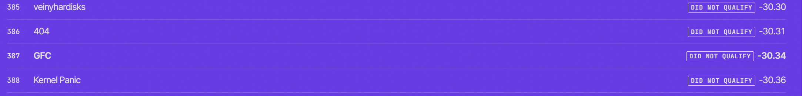

# Oval Sentinel — Builders Mech Royale

Oval Sentinel is team **GFC**'s Python bot for [Builders – Mech Royale](https://www.joinbuilders.org/buildathon): a 16-mech 3D battle royale on the Ohio State University campus. Each bot receives observations and returns movement, aim and weapon actions ten times per second, with a 50 ms response budget. The arena's zone shrinks over time; weapons, power cubes, upgrades and cover shape the fight.

## Competition result

**GFC placed 387th of 418 teams** on the final leaderboard and did not qualify for the top-32 qualifying round. The team's best practice score was **1.66 placement points** (starter baseline: 1.21); its practice leaderboard position was **396th of 418**. The scored entry was commit `6c2586be94a8`.



[Final leaderboard](https://www.joinbuilders.org/buildathon/leaderboard)

Practice placed the bot against a coordinated squad of 15 house bots, while the qualifying and final rounds used free-for-all matches. Practice scoring was the mean of **16 − placement**: 15 points for a win and zero for dying first. The final board displayed non-qualifying teams with negative scores; GFC's shown **−30.34** is a leaderboard value, not its 1.66 practice score.

## Bot strategy

The scored baseline prioritized staying alive over chasing kills:

- **Zone and movement:** move toward a safety margin inside the next zone, retreat from nearby enemy mechs, and conserve boost energy except when threatened or near the zone edge.
- **Combat:** aim at the nearest observed mech while moving away, lead gun shots using observed velocity, face the attacker to reduce rear damage, and use available laser or lightning when appropriate. Mortar firing was left unimplemented.
- **Loot and upgrades:** collect nearby cubes and a second weapon opportunistically; prioritize defensive and mobility upgrades. Avoid initiating fights with crates or NPCs in the scored baseline.
- **Map awareness:** index static buildings and use local obstacle steering and approximate line-of-fire checks, with a simple unsticking fallback.
- **Reliability:** a standard-library JSON-lines loop skips queued stale observations and sends a response for the latest tick.

The repository also contains **later, unscored changes** to zone recovery, strafing, projectile avoidance, drop capture and early crate farming. They were not part of the `6c2586be94a8` entry and should not be credited for its score. The bot remains a work in progress: local steering is not full pathfinding, and neither the later strategy changes nor their match performance have been validated in scored games. See [STRATEGY.md](STRATEGY.md) for the hypotheses and limitations, and [protocol.md](protocol.md) for the supplied protocol.

## Run locally

```sh
python3 -m unittest discover -s tests -v
python3 -u bot.py
```

The second command expects JSON-lines protocol input on stdin; stdout is reserved for protocol responses. The bot uses no Python dependencies and writes no files at runtime. It reads the map from `hello.map.dir` when available and falls back to map-free behavior otherwise.

## Official conformance check (requires the complete kit and Docker)

The checked-in `mechfight-kit.tar.gz` can be extracted into the ignored `kit/` directory. Then run the recorded-stream check on the host and, on a machine with Docker, in the competition-style sandbox:

```sh
mkdir -p kit
tar xzf mechfight-kit.tar.gz -C kit
KIT="$PWD/kit/mechfight-kit"
python3 "$KIT/check/check.py" --map-dir "$KIT/arena" -- python3 -u bot.py
docker build -t oval-sentinel .
python3 "$KIT/check/check.py" --map-dir /arena -- docker run --rm -i --network none --cpus 1 --memory 512m --read-only --tmpfs /tmp:rw,size=64m --user 65534:65534 -v "$KIT/arena:/arena:ro" oval-sentinel
```

The host-side recorded check passed, but the Docker sandbox check has not been run in this environment. The check is **not a game simulation**; passing it does not demonstrate match performance.
